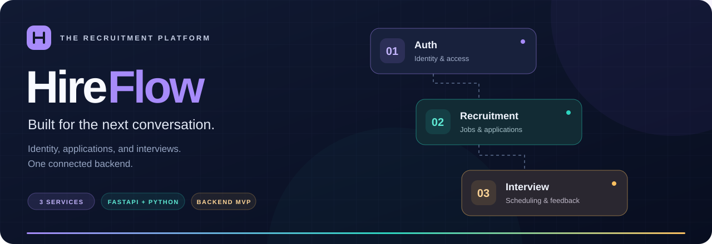

<div align="center">
  

  <br />

  
  
  
  
  
  

  <h3>From first application to the next conversation.</h3>
  <p>A recruitment backend built around three focused FastAPI services.<br />Secure identity, role-based hiring workflows, and automatic interview creation.</p>

  <p>
    <a href="#quick-start"><strong>Quick start</strong></a> ·
    <a href="#architecture"><strong>Architecture</strong></a> ·
    <a href="docs/developer-guide.md"><strong>Developer guide</strong></a> ·
    <a href="#api-explorer"><strong>API explorer</strong></a>
  </p>
</div>

---

## ✨ What HireFlow does

HireFlow models the core hiring journey: a candidate applies, a recruiter reviews the application, and shortlisting creates an interview. Each service owns its data, validates access on the backend, and exposes an interactive API through Swagger UI.

This is a **backend MVP and learning project**, built with readable synchronous Python and explicit FastAPI CRUD patterns. The repository includes the APIs, tests, and Docker setup; Swagger UI is the interface for exploring the workflow.

| | Capability | What is included |
| :---: | --- | --- |
| 🔐 | **Identity & access** | Candidate registration, protected recruiter creation, OAuth2 bearer JWTs, and Argon2 password hashing. |
| 💼 | **Jobs & applications** | Recruiter-owned jobs, job filtering, candidate applications, and application status updates. |
| 📅 | **Interview coordination** | Automatic interview creation on shortlisting, scheduling, status management, and feedback. |
| 🛡️ | **Backend safeguards** | Role and ownership checks, duplicate-application protection, and Redis login/register rate limits. |
| 🔗 | **Service communication** | Explicit HTTPX calls with timeouts, internal authentication, and retry-safe interview creation. |
| 🐳 | **Flexible development** | Local APIs with Docker infrastructure, or the complete stack through Docker Compose. |

<a id="architecture"></a>

## 🧭 Architecture

| Service | Responsibility | Host port | Data store |
| --- | --- | :---: | --- |
| 🟣 **Auth** | Accounts, credentials, tokens, and authentication rate limits | `8001` | Auth PostgreSQL + Redis |
| 🟢 **Recruitment** | Jobs, applications, and shortlist coordination | `8002` | Recruitment PostgreSQL |
| 🟠 **Interview** | Interview creation, scheduling, and feedback | `8003` | Interview PostgreSQL |

Auth issues JWTs that the APIs validate on protected requests. Recruitment calls Interview over HTTP when a recruiter shortlists an application. **Each service owns a separate PostgreSQL database**; services never query one another's databases. Redis is used only for authentication rate limiting.

```text
                          Client / Swagger UI
                                  │
               ┌──────────────────┼──────────────────┐
               ▼                  ▼                  ▼
          Auth :8001       Recruitment :8002   Interview :8003
               │                  │                  ▲  │
               ├── Redis          └── HTTPX shortlist ┘  │
               │                  │                     │
               ▼                  ▼                     ▼
         Auth database    Recruitment database   Interview database
```

The ports above are published on the host. Inside Docker, each API listens on `8000` and uses Compose service names to reach its dependencies.

<a id="quick-start"></a>

## 🚀 Quick start

**Prerequisites:** Git and Docker with Docker Compose. Python 3.12 is also needed when running the APIs locally.

### 1. Clone and configure

```bash
git clone https://github.com/PardhivAryan/HireFlow-Recruitment-Platform.git
cd HireFlow-Recruitment-Platform
cp .env.example .env
```

Edit `.env` and replace the three database password placeholders. Generate **three different secrets**, one for each of `AUTH_JWT_SECRET`, `INTERNAL_SERVICE_SECRET`, and `RECRUITER_CREATION_SECRET`:

```bash
openssl rand -hex 32
openssl rand -hex 32
openssl rand -hex 32
```

Paste each value into its corresponding setting. Keep `.env` local; only `.env.example` belongs in Git.

### 2. Start the stack

```bash
docker compose up --build -d --wait
docker compose ps
```

This starts three APIs, three PostgreSQL databases, and Redis. Data persists in named PostgreSQL volumes. Ports bind to `127.0.0.1` for local development.

### 3. Explore the APIs

Open the Swagger links below, create a candidate account, and walk through the hiring workflow. For VS Code development with local FastAPI processes, follow the [local development guide](docs/developer-guide.md#local-development).

<a id="api-explorer"></a>

## 📖 API explorer

| Service | Interactive documentation | Key routes |
| --- | --- | --- |
| **Auth** | [localhost:8001/docs](http://127.0.0.1:8001/docs) | `/auth/register` · `/auth/recruiters` · `/auth/token` · `/users/me` |
| **Recruitment** | [localhost:8002/docs](http://127.0.0.1:8002/docs) | `/jobs` · `/jobs/{job_id}/apply` · `/applications/me` |
| **Interview** | [localhost:8003/docs](http://127.0.0.1:8003/docs) | `/interviews` · `/interviews/{id}/status` · `/interviews/{id}/feedback` |

Each API also exposes `GET /health`. These links work after the services start with their default ports.

In Auth's **Authorize** dialog, enter the account email as the username. In Recruitment and Interview, paste the access token returned by `/auth/token`.

## 🔄 The hiring journey

1. **Register & sign in** — public registration creates a candidate. Create a recruiter through `/auth/recruiters` with the configured `X-Recruiter-Creation-Secret` header.
2. **Publish a job** — the recruiter creates a job; ownership comes from the authenticated JWT.
3. **Apply** — the candidate browses jobs and submits an application. Duplicate applications are rejected.
4. **Review & shortlist** — the job owner updates the application to `SHORTLISTED`. Recruitment asks Interview to create a `PENDING` interview.
5. **Schedule & follow up** — the assigned recruiter schedules the interview and records feedback; the candidate can view their interview.

If Interview is unavailable, Recruitment returns `503` without saving the shortlist status. Repeating the request reuses a matching interview rather than creating a duplicate.

| Candidate | Recruiter | Admin |
| --- | --- | --- |
| Browse jobs and apply | Create and manage owned jobs | Administrative access |
| View own applications | Review applicants for owned jobs | Manage jobs and application statuses |
| View own interviews | Schedule assigned interviews and add feedback | Manage interviews |

Public registration cannot create recruiter or admin accounts. See the [authentication guide](docs/developer-guide.md#jwt-authentication-and-roles) for provisioning and access rules.

## 🗂️ Project structure

```text
HireFlow-Recruitment-Platform/
├── auth-service/             # Accounts, JWTs, and Redis rate limiting
├── recruitment-service/      # Jobs, applications, and HTTPX integration
├── interview-service/        # Interview scheduling and feedback
├── docs/
│   ├── assets/               # Repository artwork
│   └── developer-guide.md    # Configuration, API reference, and operations
├── .env.example              # Safe configuration template
├── .gitignore
├── docker-compose.yml        # Complete local stack
└── README.md
```

Each service contains `app/`, `tests/`, a `Dockerfile`, and runtime/development requirements. Routes, schemas, models, settings, and dependencies are kept explicit and close to standard FastAPI patterns.

## 🧪 Testing

The pytest suites cover authentication, authorization, ownership, CRUD, rate limiting, interview scheduling, and HTTP service communication. Tests use **PostgreSQL**, with real Redis for authentication rate-limit tests and mocked HTTPX calls in the Recruitment suite.

Start the infrastructure:

```bash
docker compose up -d auth-db recruitment-db interview-db redis
```

Then run the following in each service directory (`auth-service`, `recruitment-service`, and `interview-service`):

```bash
python3.12 -m venv .venv
source .venv/bin/activate
python -m pip install -r requirements-dev.txt
python -m pytest -q
```

Configure `.env` first. Tests create isolated PostgreSQL schemas; Auth tests use isolated Redis key namespaces. See [testing details and connection overrides](docs/developer-guide.md#testing).

## ⚙️ CI/CD Pipeline

HireFlow uses **GitHub Actions** for continuous integration and continuous delivery.

### Continuous Integration

The CI workflow runs automatically on pushes to the `main` branch and pull requests targeting `main`.

```text
Push / Pull Request
        ↓
GitHub Actions
        ↓
Start PostgreSQL + Redis
        ↓
Run Auth tests
        ↓
Run Recruitment tests
        ↓
Run Interview tests
        ↓
Validate Docker Compose
        ↓
Build FastAPI Docker images
```

If any test, Docker Compose validation, or Docker image build fails, the CI workflow fails.

### Continuous Delivery

After CI completes successfully for a push to the `main` branch, the CD workflow runs automatically.

```text
CI Success
        ↓
CD Workflow
        ↓
Build Auth Docker image
        ↓
Build Recruitment Docker image
        ↓
Build Interview Docker image
        ↓
Publish images to GHCR
```

The Docker images are published to **GitHub Container Registry (GHCR)**:

- `ghcr.io/pardhivaryan/hireflow-auth-service`
- `ghcr.io/pardhivaryan/hireflow-recruitment-service`
- `ghcr.io/pardhivaryan/hireflow-interview-service`

Each image is published with both the `latest` tag and the Git commit SHA, providing traceable, versioned container images.

The current pipeline implements **Continuous Delivery**. Automatic deployment to a production hosting environment is not part of the current MVP.

## 📚 Go deeper

| Guide | What you will find |
| --- | --- |
| [Environment setup](docs/developer-guide.md#environment-setup) | Every setting, service port, and secret explained |
| [Local development](docs/developer-guide.md#local-development) | Run the three APIs locally with infrastructure in Docker |
| [Complete Docker setup](docs/developer-guide.md#complete-docker-setup) | Health checks, logs, volumes, and switching run modes |
| [Jobs & applications](docs/developer-guide.md#jobs-and-applications) | Endpoints, filters, statuses, and access rules |
| [Interview workflow](docs/developer-guide.md#interview-workflow-and-httpx-communication) | Internal requests, retries, scheduling, and feedback |
| [Redis rate limiting](docs/developer-guide.md#redis-rate-limiting) | Fixed windows, expiry, `429`, and outage handling |

## 📝 MVP boundaries

HireFlow intentionally keeps the architecture small: synchronous SQLAlchemy sessions, direct HTTP communication, and table creation at startup. It currently supports one interview per application, shared-secret JWT validation, and local HTTP. There is no refresh-token flow, schema migration system, calendar integration, or automatic reconciliation between service databases.

Interview feedback is visible to the candidate who owns the interview. Issued tokens can remain valid in Recruitment and Interview until expiry after an Auth account change. See the [design notes and limitations](docs/developer-guide.md#concepts-beyond-basic-crud-and-mvp-limits) before extending the project.

## 🔮 Future Scope

The current version focuses on a working microservices MVP.

Planned improvements include:

- Add Redis caching for frequently accessed job data.
- Add Traefik as a reverse proxy and load balancer.
- Horizontally scale FastAPI services using multiple replicas.
- Add Alembic for database schema migrations.
- Add refresh-token and token-revocation support.
- Add structured logging and request correlation IDs.
- Add load testing using Locust or k6.
- Add CI/CD using GitHub Actions.
- Add monitoring and observability in a later version.

---

<div align="center">
  <strong>HireFlow</strong><br />
  <sub>Three services. One connected hiring workflow.</sub>
</div>
